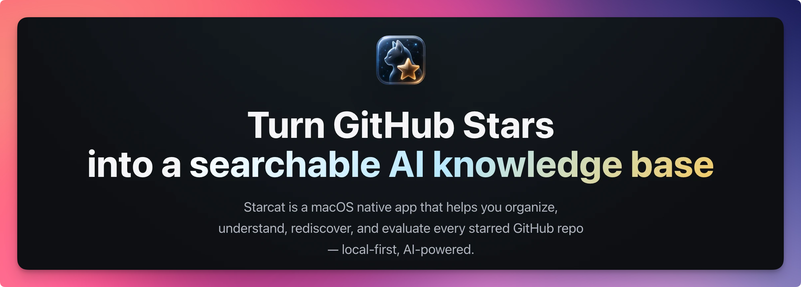
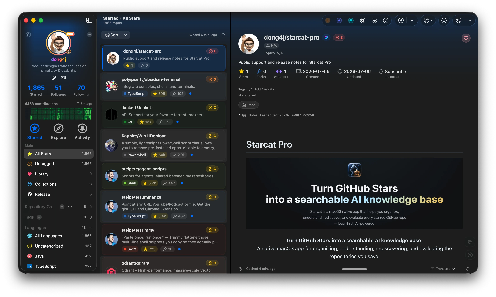

## The job

GitHub Stars are easy to collect and hard to find again. Months later you often have a name and a stale description. You want the sentence "that local vector library" to become the repository again.

Starcat syncs Stars to this Mac and uses tags, notes, status, and search for that. AI and the knowledge base come after. Explore, Weekly, and notifications are for finding new work, not for digging through the old pile.

Each page starts with the situation you are stuck in, then names the feature that answers it. A page without a capsule works on App Store 1.9.1 and Direct 1.9.6. A red capsule is store-only. A green capsule is Direct-only, or only on Direct 1.9.6 today. The map is [Channels and current versions](/getting-started/channels).

Website: [starcat.ink](https://starcat.ink)  
App Store: [Starcat for GitHub](https://apps.apple.com/cn/app/starcat-for-github/id6788809803?mt=12)

<Frame caption="Product banner">
  
</Frame>

<Frame caption="Main three-column window">
  
</Frame>

## Who it is for

- Indie developers who need to find a solution they starred months ago
- Writers / media following trends, weeklies, and topic lists
- macOS users who want local-first data and [BYOK](/subscribe/byok) AI (Apple Silicon, macOS 15+)

## While you read

Tags, notes, and status stay on this Mac. Cross-device cloud sync is not shipped; [back up](/data-privacy/backup) before you move machines. Suggested tags and AI notes are written only after you confirm. Starring does not ingest, and unstarring does not remove ingest. RAG searches ingested repos by default. See [Knowledge base](/knowledge-base/overview). App Store and Direct use separate data directories and Pro entitlements. See [Install](/getting-started/installation).

## Suggested reading order

<Steps>
  <Step title="Install and sign in">
    [Install](/getting-started/installation) → [Quickstart](/getting-started/quickstart) → [Connect GitHub](/getting-started/github-connection)
  </Step>
  <Step title="Three-column UI">
    [Overview](/main-interface/overview) → [Sidebar](/main-interface/sidebar)
  </Step>
  <Step title="Start organizing">
    [Tags](/manage-stars/tags) → [Notes and status](/manage-stars/notes-and-status)
  </Step>
  <Step title="Go deeper as needed">
    [Search Center](/search/search-center) · [Knowledge base](/knowledge-base/overview) · [Agent](/agent-workspace/overview) · [Plans](/subscribe/plan-comparison)
  </Step>
</Steps>

## Requirements

macOS 15 Sequoia+, Apple Silicon. Full detail: [Install](/getting-started/installation).

## Related

- [Docs home](/)
- [CLI](/cli/installation)
- Support: [dong4j@gmail.com](mailto:dong4j@gmail.com)
