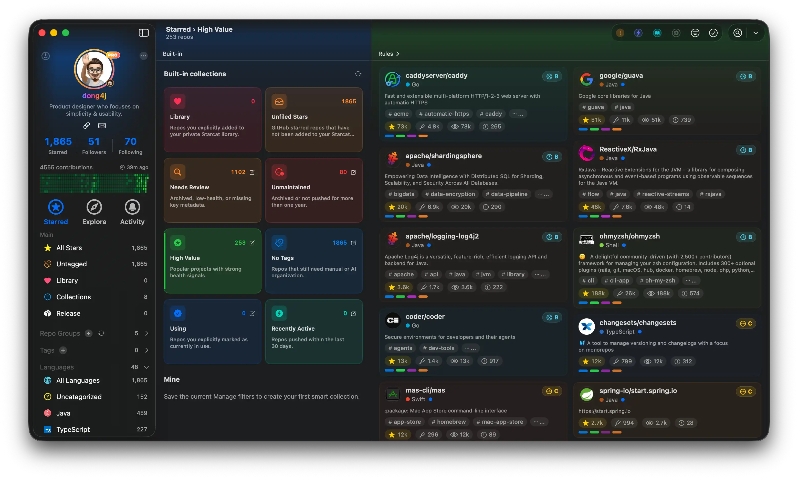

## The job

Every time you open Starcat you look for the same set: still untagged, currently in use, or starred but not ingested. You do not want to rebuild that filter.

A smart collection stores the rule. Membership changes when the data changes. Free accounts get 4 custom collections.

<Note>
  Free: **4** custom collections. Pro: unlimited. Built-in system collections usually do not count against the cap.
</Note>

<Frame caption="Smart collections">
  
</Frame>

If that file is missing, capture `images/screenshots/smart-collections.webp` (sidebar collections + rule editor).

## How to use them

Sidebar **Manage → Smart Collections**: overview of system + custom; open a name for the matching list; gear edits rules.

System names follow the app. Typical views: in library / not ingested, needs review, low maintenance, untagged, using, recently active. Use them as a triage start, then [batch](/manage-stars/batch-operations).

## Custom collections

1. Tap "+"
2. Add conditions: language, tags, status, Stars, updated time, ingest, and similar; AND / OR
3. Name and save; it appears in the sidebar

Hitting the cap is gated → [Plans](/subscribe/plan-comparison).

Editing, renaming, or deleting a collection does not delete repositories.

## vs filters

| | Filters | Smart collection |
|--|---------|------------------|
| Lifetime | This list session | Stays in the sidebar |
| Best for | One-off narrowing | A view you reopen every day |

## Related

- [Filters](/search/filters)
- [Tags](/manage-stars/tags)
