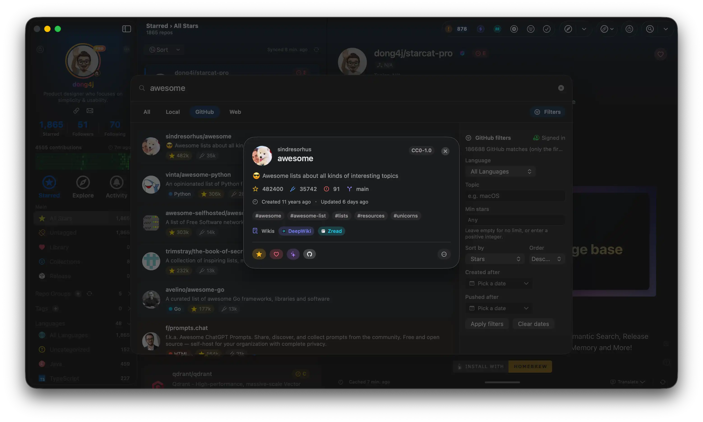

## The job

You are not sure whether the thing you want is in a repository you already starred, still on GitHub, or on a web page. ⌘F on the current list cannot cross that boundary.

Search Center (default **⌘K**) puts those sources in one panel. App Store 1.9.1 and Direct 1.9.6 both have it. Smart discovery inside the source filter is Direct 1.9.6 only. See [Smart discovery](/search/smart-discovery).

<Frame caption="Search Center / global search">
  
</Frame>

If that file is missing, capture `images/screenshots/global-search.webp` (four scopes plus one GitHub hit).

## How to open it

- Default **⌘K**
- Global search control next to the list
- Menu **Open global search** (copy follows the app)

## Four scopes

| Scope | Searches | Notes |
|-------|----------|-------|
| **All** | Aggregated sources | When you are unsure |
| **Local** | Your Stars / local library | FTS; same family as list search |
| **GitHub** | GitHub Search API | Ingest badge; Star / ingest |
| **Web** | External Search | See [External search](/search/external-search) |

Web search is available to everyone (the provider may need a key). Semantic search and [smart discovery](/search/smart-discovery) are free on the on-device model, and require Pro when you switch that task to a cloud provider.

Filter results by source: keyword, semantic, GitHub, web, or smart discovery. Each source has its own count, and the same repository is listed once. Unsuitable results are hidden by the same rules.

GitHub scope filters typically include language, topic, minimum stars, created / pushed time, and sort. Use it to find unstarred repos, then ingest or Star in one step.

## What you can do on a result

- Open local detail or the system browser
- Ingest / Star (depends on result type and login)
- Jump from a GitHub hit into your tidy workflow

## Notes

| Symptom | What to try |
|---------|-------------|
| ⌘K does nothing | [Shortcuts](/settings/shortcuts) remapped or conflicting |
| Empty GitHub scope | Login and rate limit → [FAQ sync](/faq/sync) |
| Web scope fails | Key / test in [Integrations → External Search](/settings/integrations) |
| Local miss on a note word | Confirm the note is saved; try [list search](/search/global-search) |

## Related

- [List search](/search/global-search)
- [Filters](/search/filters)
