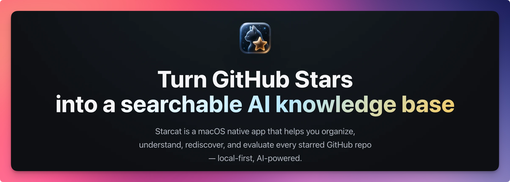
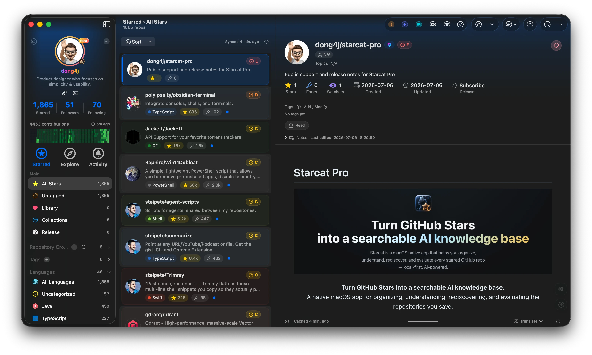

## 你要解决的事

GitHub Stars 很好攒、很难找。过几个月再回头，往往只剩仓库名和一句过时的 description。你要的是把那句「那个做本地向量的」变回那个仓库。

Starcat 把收藏同步到本机，用标签、笔记、状态和搜索接住这件事。AI 和知识库是下一步。探索、周刊和通知用来发现新的，不是用来翻旧账。

每页先写你卡住的情况，再写哪个功能接住。没有胶囊的功能，App Store 1.9.1 和 Direct 1.9.6 都有。红胶囊是商店专属，绿胶囊是 Direct 专属，或当前只有 Direct 1.9.6 和 1.9.7 Beta 1。对照表在 [渠道与当前版本](/zh-Hans/getting-started/channels)。

官网与下载：[starcat.ink](https://starcat.ink)  
App Store：[Starcat for GitHub](https://apps.apple.com/cn/app/starcat-for-github/id6788809803?mt=12)

<Frame caption="产品横幅">
  
</Frame>

<Frame caption="主界面三栏">
  
</Frame>

## 适合谁

- 独立开发者：要快速找回几个月前 Star 过的库
- 技术写作 / 媒体：要跟趋势、周刊和主题清单
- 希望数据留在本机、AI 走 [BYOK](/zh-Hans/subscribe/byok) 的 macOS 用户（Apple Silicon，macOS 15+）

## 读文档时记住的几条

标签、笔记、状态只在本机。跨设备云同步尚未上线，换机器请 [备份](/zh-Hans/data-privacy/backup)。标签推荐和 AI 笔记要你确认后才写入。Star 不会自动入库，Unstar 也不会自动移出；RAG 默认只搜已入库仓库，见 [知识库概述](/zh-Hans/knowledge-base/overview)。App Store 与 Direct 的数据目录和 Pro 授权方式都不同，见 [安装](/zh-Hans/getting-started/installation)。

## 建议阅读顺序

<Steps>
  <Step title="装好并登录">
    [安装](/zh-Hans/getting-started/installation) → [快速开始](/zh-Hans/getting-started/quickstart) → [连接 GitHub](/zh-Hans/getting-started/github-connection)
  </Step>
  <Step title="熟悉三栏">
    [界面概览](/zh-Hans/main-interface/overview) → [侧边栏](/zh-Hans/main-interface/sidebar)
  </Step>
  <Step title="开始整理">
    [标签](/zh-Hans/manage-stars/tags) → [笔记与状态](/zh-Hans/manage-stars/notes-and-status)
  </Step>
  <Step title="按需深入">
    [Search Center](/zh-Hans/search/search-center) · [知识库](/zh-Hans/knowledge-base/overview) · [Agent](/zh-Hans/agent-workspace/overview) · [Pro 对比](/zh-Hans/subscribe/plan-comparison)
  </Step>
</Steps>

## 系统要求

macOS 15 Sequoia+，Apple Silicon。完整说明见 [安装](/zh-Hans/getting-started/installation)。

## 相关

- [手册首页](/zh-Hans)
- [CLI](/zh-Hans/cli/installation)
- 支持：[dong4j@gmail.com](mailto:dong4j@gmail.com)
